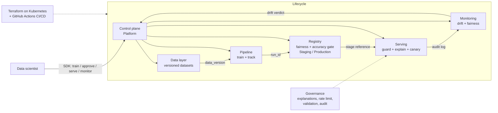

# 🏏 Cricket MLOps Platform

A small but complete **production MLOps platform** for a cricket analytics team. It takes a cricket
dataset all the way to a **monitored, explained, defended, self-renewing** production model, behind
one self-service SDK.

It's built to be **easy**. It needs only plain Python, no servers to set up, and one command runs
the whole thing.

```bash
pip install -r requirements.txt
python run_demo.py      # one full lap of the MLOps loop
pytest -q               # 11 tests covering every rubric item
```

---

## What the demo does

```
[1] Train on data version innings@2024.06  -> tracked run -> promotion gate -> Staging
[2] Human approval                          -> Production
[3] Serve: validated, rate-limited, explained (top reasons), audited
[4] Same-season traffic                     -> monitor: no drift, fairness OK
[5] New season (batting averages jump)      -> monitor: DRIFT on batting_average
[6] Closed loop: drift -> auto-retrain on newest data -> same fairness + accuracy gates
[7] Canary: 20% of traffic to the new model -> approval -> Production
[8] Lineage: model v2 -> run -> data version + fingerprint -> seed -> metrics
[9] Rollback in one call
[10] Audit trail of every decision and governance action
```

## Architecture



Components only talk through **stable artifacts**: a *data version*, a *run ID*, a *registry stage*,
the *audit log* and a *drift verdict*. That's why lineage and governance hold at every boundary.

## Project layout

```
cricket-mlops-platform/
├── mlplatform/
│   ├── config.py         all policy in one place (seed, fairness limits, drift alpha, rate limit)
│   ├── data.py           versioned datasets + fingerprint + recent eval slice
│   ├── tracking.py       experiment tracker: params, metrics, model per run
│   ├── pipeline.py       load data -> train -> evaluate -> track
│   ├── registry.py       versions, stages, lineage, promotion gate, rollback
│   ├── serving.py        load by stage, guard, explain, canary, audit
│   ├── monitoring.py     KS-test drift + equal-opportunity / selection-rate fairness
│   ├── governance.py     explanations, rate limiter, input validation, audit log
│   └── control_plane.py  the self-service SDK (paved road + escape hatch)
├── api.py                FastAPI: /predict /health /lineage /metrics
├── run_demo.py           the whole loop in one command
├── tests/                11 tests (end-to-end + each gate and guard)
├── infra/                Terraform: namespace, storage, deployment, service, autoscaler
├── Dockerfile
└── .github/workflows/    CI/CD: tests + model gate, terraform checks, image build + smoke test
```

## Self-service SDK

Users think in **datasets, models and deployments**. Everything else is wired in by default.

```python
from mlplatform import Platform

platform = Platform()                         # state lives in ./.mlops

result = platform.train("innings@2024.06")    # tracked + gated -> {'decision': 'PROMOTED', ...}
platform.approve("head-of-analytics")         # Staging -> Production (human sign-off)

serving = platform.serve()                    # or platform.serve(canary_fraction=0.2)
serving.predict("coach", [53.6, 131.0, 0.61, 48.0], group=1)
# {'in_form': True, 'model_version': 1,
#  'top_reasons': [{'feature': 'batting_average', 'contribution': 0.34}, ...]}

platform.monitor()                            # drift + fairness from logged decisions
platform.maybe_retrain()                      # drift? -> retrain on newest data -> re-gate
platform.lineage()                            # version -> run -> data version -> seed -> metrics
platform.rollback(by="on-call")
```

**Escape hatch** (for genuine exceptions such as an urgent hotfix). It's off by default and
must be enabled per project. It skips only the "must beat Production" check: fairness is
still enforced, and every use is written to the audit log.

```python
Platform(escape_hatch=True).force_promote(run_id, by="on-call", reason="urgent hotfix")
```

## How each requirement is met

| Rubric item | Where |
|---|---|
| **Lineage + reproducibility** (15%) | Every run logs `data_version`, `data_fingerprint`, `seed`, params and metrics. `platform.lineage()` walks Production → run → data. A test proves the same data version gives an identical model. |
| **Gated promotion** (15%) | `registry.promote_if_better`: equal-opportunity fairness gap ≤ 0.15 **and** beats the incumbent on the recent eval slice. The first model auto-promotes to **Staging** only, and **Production needs `approve()`**. |
| **Serving correctness + safety** (15%) | Loads by **stage**, rate-limits (5 req/s per client), validates shape, type and range (out-of-distribution rejection), returns a **coarse yes/no** (no scores), and attaches the top-3 reasons. |
| **Monitoring + audit** (15%) | KS-test drift and live selection-rate fairness are computed **from the audit log**. Every prediction, block, gate decision and stage change is audited. Drift triggers retraining. Canary fairness gates approval. |
| **Loop closure + self-service** (20%) | `maybe_retrain()` closes the loop, and the `Platform` SDK is the paved road with an audited, opt-in escape hatch. |
| **Infra + CI/CD** (10%) | `infra/` Terraform (namespace, PVC, Deployment, Service, **HPA autoscaling**). GitHub Actions gates every push on tests and the model gate, `terraform fmt` + `validate`, and an image build with a container smoke test. |
| **Architecture + integration** (10%) | Components communicate only through artifacts (data version, run ID, stage, audit log, drift verdict). See the diagram above. |

## Run the HTTP API

```bash
uvicorn api:create_app --factory --port 8000
```

```bash
curl -X POST localhost:8000/predict -H 'Content-Type: application/json' -H 'X-Client-Id: coach' \
  -d '{"batting_average": 53.6, "strike_rate": 131, "boundary_pct": 0.61, "away_average": 48, "group": 1}'
curl localhost:8000/metrics     # Prometheus format: traffic, blocks, drift, fairness gap
curl localhost:8000/lineage
```

On first boot, the API trains, gates and approves a bootstrap model, so there is always something to serve.

## Deploy to Kubernetes (optional)

```bash
kind create cluster --name cricket
docker build -t cricket-mlops:latest .
kind load docker-image cricket-mlops:latest --name cricket
cd infra && terraform init && terraform apply
kubectl -n cricket-mlops port-forward svc/cricket-serving 8000:80
```

## Design notes

- **Why no MLflow, SHAP or Postgres?** To keep it easy to run. Each is replaced by a small file that
  works the same way, so swapping in the real tool later only touches one module:

  | Here | Production swap |
  |---|---|
  | `tracking.py` (folder per run) | MLflow Tracking |
  | `registry.py` (`registry.json`) | MLflow Model Registry |
  | `data.py` (frozen recipes + hash) | DVC / lakeFS / Feast |
  | `explain()` (exact tree-path contributions) | SHAP `TreeExplainer` |
  | `audit.jsonl` | Postgres / Kafka |
  | `/metrics` text | Prometheus + Grafana |

- **Fairness:** the protected `group` is never a model input. It is used only to measure equal
  opportunity at promotion and selection-rate gaps on live traffic.
- **Drift alpha is 0.001**, not 0.05, because four features are tested at once and a looser
  threshold raised false alarms on same-season data.
- **Limitations:** the rate limiter is in-memory per pod, and the single `ReadWriteOnce` volume suits a
  one-node cluster (kind or minikube). A multi-node setup would use Redis and object storage.

## Extension ideas

1. **Automatic canary rollback:** compare canary vs Production metrics during `serve(canary_fraction=…)`
   and call `rollback()` automatically when they degrade.
2. **Multi-tenancy:** one `Platform(home=f".mlops/{team}")` per team, with Kubernetes namespaces and
   quotas in Terraform.
3. **LLMOps:** a retrieval-augmented cricket Q&A service registered, monitored and guarded through the
   same `Platform` paved road.
